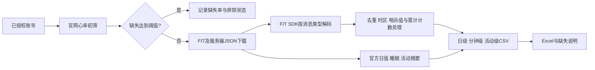

# Garmin 手环数据提取与清洗教程

从已授权的 Garmin Connect 账号下载日常监测和活动 FIT，补充服务器端日汇总与睡眠信息，整理成日级、分钟级和活动级三张表。

本仓库只有通用代码、中文教程、数据字典及**只有表头的 CSV**。没有真实账号、密码、受访者名单、健康数据、设备序列号、轨迹、登录缓存或真实账号截图。

## 从哪里开始

1. 阅读 [完整操作教程](docs/tutorial.md)，了解数据来源、安装、筛选、下载与处理顺序。
2. 阅读 [数据字典](docs/data_dictionary.md)，查每个变量的中文含义、单位及统计来源。
3. 遇到时间重复、心率差异、睡眠分期或血氧问题，阅读 [常见问题](docs/faq.md)。
4. 复用或发布时，阅读 [隐私与发布边界](docs/privacy.md)。

## 能得到什么

| 输出 | 一行代表什么 | 主要变量 | 时间颗粒度 |
|---|---|---|---|
| `daily_data` | 一名受访者的一天 | 心率统计、步数、距离、活动热量、强度分钟、楼梯高度、身体电量、睡眠 | 本地日 |
| `minute_data` | 一名受访者的一分钟 | 心率、压力、血氧、有效观测计数、部分厂商字段 | 整理为分钟；原始采样不一定每分钟都有 |
| `activities` | 一项主动记录的运动 | 开始时间、距离、时长、热量、心率、步频、配速、步长 | 活动级摘要；原始 FIT 另存 |
| 缺失说明 | 一名受访者或受访者的一天 | 官网心率初筛、纳入状态、分钟缺失率、睡眠/官方步数可用性、接口错误 | 受访者级与日级 |

呼吸、HRV、身体电量等补充接口 JSON 也会保存。固定三表没有对应字段的扩展指标，不擅自追加到正式表中。

## 来源与处理顺序



“Garmin Connect 服务器端接口”指登录后访问的非公开 JSON 服务；`garminconnect` 是第三方 Python 封装。这与公开的 Garmin Health API 不同。接口可用性和字段会随服务、设备及设置变化。

## 快速运行

建议 Python 3.12 和 `uv`。安装依赖在你自己的终端执行：

```bash
uv sync
```

把 `examples/accounts.example.json` 复制到仓库外的私有工作目录，填写本地受访者编号及环境变量名。账号和密码通过环境变量提供，**不写入仓库**。Mac 的 zsh 可用隐藏输入：

```bash
read -rs 'GARMIN_ACCOUNT_001?Garmin account: '
export GARMIN_ACCOUNT_001
read -rs 'GARMIN_PASSWORD_001?Garmin password: '
export GARMIN_PASSWORD_001
```

以下日期是教程示例，运行前替换为自己的观测期。`--end` 是**不包含的结束日零点**；要包含某天全天，结束日应填写次日。

```bash
uv run python src/download.py --accounts ../private_work/accounts.json --root ../private_work --start 2030-01-01 --end 2030-01-15
uv run python src/process.py --root ../private_work
uv run python src/export_excel.py --root ../private_work
```

正式 Excel 输出为私有工作目录里的 `results/dataset.xlsx`；缺失说明为 `results/missingness.xlsx`。CSV 与原始 FIT/JSON 都留在私有目录。建议先用一个账号验证配置，再扩大到整批。

```bash
uv run python -m unittest discover -s tests
uv run python src/privacy_check.py
```

## 目录

```text
README.md                       项目入口
docs/tutorial.md                提取清洗教程
docs/data_dictionary.md         全部字段含义、单位及来源
docs/faq.md                     时间、聚合、睡眠、血氧等常见问题
docs/privacy.md                 本地资料与发布目录的隔离规则
src/download.py                 账号配置、心率初筛、下载与断点续传
src/fit2csv.py                  官方FIT SDK解码与压缩时间戳还原
src/daily_summary.py            FIT日级统计和累计值归属
src/steps_recount.py            活动类型分项步数重算
src/sleep_download.py           睡眠分期、摘要及质控
src/process.py                 逐人处理，合并正式三表与缺失说明CSV
src/export_excel.py             低内存Excel流式输出
src/privacy_check.py            发布文件白名单与内容检查
schemas/                       数据表字段及中文字典
examples/                      占位配置与仅表头CSV
tests/                         时间、去重、初筛和隐私边界测试
```

## 官方和依赖网址

- Garmin 中国登录：https://connect.garmin.cn/signin/
- Garmin 国际版：https://connect.garmin.com/
- FIT 官方资料：https://developer.garmin.com/fit/overview/
- Garmin FIT Python SDK：https://github.com/garmin/fit-python-sdk
- `garminconnect`：https://github.com/cyberjunky/python-garminconnect
- `uv`：https://docs.astral.sh/uv/
- `openpyxl`：https://openpyxl.readthedocs.io/

代码针对已验证的日常监测导出规则整理；新设备需要确认实际字段及采样方式。公开版不包含登录后界面的真实健康截图，说明通过流程图、字段字典及空表头提供。
